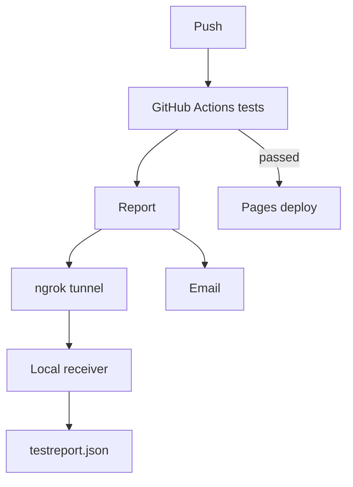

# Assignment Submission Portal

Author: Muhammad Munir | Reg No: CIIT/FA22-BCS-071/ATK

Course: DevOps for Cloud Computing (CSC418) · Instructor: Mr. Babar Shazad

COMSATS University Islamabad, Attock Campus · Lab Mid

[](https://github.com/muhammadmunir1/assignment-submission-portal/actions/workflows/ci.yml)


Students submit an assignment through a small PHP portal: full name, registration number, title, and an `http` or `https` link. GitHub Actions runs the PHPUnit suite on every push, writes `testreport.json`, sends that file through ngrok to a receiver on the lab machine, and emails the result. A push to `main` publishes the static portal to GitHub Pages only when the test job is green.

## Pipeline



## Features

- Portal at `public/` with server-side validation and a JSON API at `public/api.php`.
- PHPUnit suite in `tests/`, including the three required cases for a valid save, a missing registration number, and an invalid URL.
- `scripts/build-report.php` reads `junit.xml` and writes `testreport.json`.
- `scripts/send-report.php` POSTs that file to `REPORT_URL` with the `X-Report-Token` header. It tries five times, three seconds apart, with a ten-second timeout.
- `receiver/receiver.php` checks the token, stores the latest report at `testreport.json`, and keeps a copy under `reports/` so a later run does not erase a failure.
- `scripts/build-email.php` writes `email.html`. The workflow sends it with `dawidd6/action-send-mail` when `REPORT_EMAIL_TO` is set.
- The `deploy` job publishes `public/` without `api.php`. On GitHub Pages the portal has no PHP API, so the page uses its browser demo store.

## Project structure

```
src/Validator.php
src/Store.php
src/SubmissionService.php
src/Api.php
public/index.html
public/api.php
public/assets/styles.css
public/assets/app.js
tests/SubmissionTest.php
tests/ApiTest.php
receiver/receiver.php
receiver/.env.example
scripts/build-report.php
scripts/build-email.php
scripts/send-report.php
scripts/report-local.php
scripts/email-preview.php
.github/workflows/ci.yml
composer.json
phpunit.xml
README.md
DEMO.md
```

`vendor/`, `data/`, `testreport.json`, `junit.xml`, `email.html`, `reports/`, `dist/`, and `receiver/.env` are gitignored.

## Prerequisites

- PHP 8.1 or newer, with the `mbstring`, `curl`, and `json` extensions
- Composer
- Git
- ngrok, with a static domain

The GitHub Actions job installs PHP 8.2.

## Run it locally

Install dependencies and create the receiver environment file:

```bash
composer install
```

```bash
copy receiver\.env.example receiver\.env
```

On macOS or Linux, use `cp receiver/.env.example receiver/.env`. Set `REPORT_TOKEN` in `receiver/.env` to the same value you will store in the `REPORT_TOKEN` GitHub secret. `receiver/.env.example` ships with `REPORT_TOKEN=change-me`. An empty token makes the receiver accept every request and log a warning.

Start the portal:

```bash
composer serve
```

Open http://localhost:8000.

Run the tests:

```bash
composer test
```

Start the receiver:

```bash
composer receiver
```

Open http://localhost:4000. `GET /health` returns `{"ok":true}`.

Start the tunnel to port 4000. Current ngrok:

```bash
ngrok http --url=<your-static-domain> 4000
```

Older ngrok builds use `--domain` instead of `--url`:

```bash
ngrok http --domain=<your-static-domain> 4000
```

To exercise the same path on the machine, with the receiver already running:

```bash
composer report:local
```

That runs PHPUnit, writes `junit.xml` even when tests fail, builds `testreport.json`, and POSTs it to `http://localhost:4000/report`.

Preview the email HTML without sending it:

```bash
composer email:preview
```

## GitHub secrets

Create these in the repository under Settings, Secrets and variables, Actions.

| Secret | What it is | Must match |
|---|---|---|
| `REPORT_URL` | Address the workflow POSTs to. Use `https://<static-domain>/report`. | The ngrok domain that forwards to the receiver on port 4000. The path is `/report`. |
| `REPORT_TOKEN` | Shared secret sent in the `X-Report-Token` header. | `REPORT_TOKEN` in `receiver/.env`. |
| `REPORT_EMAIL_TO` | Inbox that receives the HTML report. The send step is skipped when this is empty. | Nothing on the receiver. |
| `EMAIL_USERNAME` | Gmail address used to sign in to `smtp.gmail.com`. The From line is `CI Reports <this address>`. | Nothing on the receiver. |
| `EMAIL_PASSWORD` | Gmail App Password for that account. This is not the normal Gmail password. | Nothing on the receiver. |

Only `REPORT_TOKEN` has to match `receiver/.env`. The workflow reads the token from the secret. It does not read `receiver/.env`.

## GitHub Pages

The repository must be public on a free plan. In the repository, open Settings, Pages, and set Source to GitHub Actions.

The `deploy` job runs only when both of these are true:

- the event is a push to `refs/heads/main`
- the `test` job succeeded

The published URL is printed by the Deploy to GitHub Pages step as `page_url`. It is usually `https://<your-username>.github.io/<your-repo>/`.

## Gmail

1. Turn on 2-Step Verification for the Google account.
2. Create an App Password for Mail.
3. Store the Gmail address in `EMAIL_USERNAME`.
4. Store the App Password in `EMAIL_PASSWORD`.
5. Store the destination address in `REPORT_EMAIL_TO`.

The workflow connects to `smtp.gmail.com` on port 465 with TLS. A mail failure is `continue-on-error`, so it warns and does not by itself decide whether the job is red.

## Report JSON

`scripts/build-report.php` writes this shape. `errorMessage` is present only when `status` is `error`. The receiver adds `receivedAt` when it saves the file.

```json
{
  "repository": "your-username/your-repo",
  "branch": "main",
  "commitSha": "0123456789abcdef0123456789abcdef01234567",
  "commitShort": "0123456",
  "runId": "1234567890",
  "runNumber": "12",
  "runUrl": "https://github.com/your-username/your-repo/actions/runs/1234567890",
  "actor": "your-username",
  "timestamp": "2026-11-17T21:59:26+00:00",
  "status": "passed",
  "summary": {
    "total": 20,
    "passed": 20,
    "failed": 0,
    "skipped": 0
  },
  "tests": [
    {
      "name": "test_missing_registration_number_is_rejected_with_validation_message",
      "class": "App\\Tests\\SubmissionTest",
      "result": "passed",
      "durationMs": 4,
      "failureMessage": null
    }
  ]
}
```

A full file has one object per PHPUnit test case. The suite currently has 20 tests. On a failure, `result` is `failed` and `failureMessage` holds the assertion text with the workspace path removed.

Status rules in `scripts/build-report.php`:

- `passed` when `junit.xml` contains at least one test case and none failed. A PHPUnit `<failure>` or `<error>` both count as failed.
- `failed` when one or more cases failed.
- `error` when `junit.xml` is missing, empty, unreadable, or has no test cases. The file then includes `errorMessage`.

What the workflow does with that result:

1. Run automated tests uses `continue-on-error`, so the report is still built after a red suite.
2. Build test report, Upload test report, Send report to local receiver, Build email, and Send email all use `always()`.
3. Fail the job when tests failed runs last. It exits 1 when `steps.tests.outcome == 'failure'`, which makes the `test` job red.
4. The `deploy` job has `needs: test` and no `always()`. A failed test job skips deploy, so the site already on Pages stays as it was.
5. A push to a branch other than `main`, and a manual `workflow_dispatch` run, also skip deploy.

## Troubleshooting

| Symptom | What to check |
|---|---|
| ngrok URL changed | A free URL without a static domain changes every time ngrok starts. Update the `REPORT_URL` secret to `https://<new-domain>/report` and keep the receiver on port 4000. Prefer `--url` or `--domain` so the secret stays stable. |
| Receiver returns 401 | The `X-Report-Token` header does not match `REPORT_TOKEN` in `receiver/.env`. Set the GitHub secret `REPORT_TOKEN` to that same value. The receiver log says `REJECTED unauthorized`. |
| Receiver not running | `composer receiver` must be listening before the workflow sends. `http://localhost:4000/health` should return `{"ok":true}`. `send-report.php` tries five times, then prints a `::warning::` and exits 1. That step is `continue-on-error`, so the warning alone does not fail the job. |
| Pages 404 | Source must be GitHub Actions, the repository must be public on a free plan, and the push must be to `main` after a green `test` job. Wait for the `deploy` job. A request to `api.php` on Pages is expected to 404, because the deploy step deletes `dist/api.php`. |
| Gmail authentication error | `EMAIL_USERNAME` is the full Gmail address. `EMAIL_PASSWORD` is an App Password created after 2-Step Verification, not the account password. The server is `smtp.gmail.com` port 465. If `REPORT_EMAIL_TO` is empty, the send step is skipped. |
| Windows firewall | Allow `php.exe` for ports 8000 and 4000, and allow `ngrok.exe`. If http://localhost:4000 works but GitHub Actions cannot deliver, the tunnel is not reaching the receiver. |

## Evidence checklist

- Repository URL.
- Screenshot of a passing Actions run.
- Screenshot of a failing Actions run, including the failing test name and message.
- Screenshot of the corrected green run.
- GitHub Pages URL.
- The passing email and the failing email, or screenshots of both.

`DEMO.md` is the step-by-step runbook for those three pushes.

## Author

Muhammad Munir | Reg No: CIIT/FA22-BCS-071/ATK

Course: DevOps for Cloud Computing (CSC418) · Instructor: Mr. Babar Shazad

COMSATS University Islamabad, Attock Campus · Lab Mid
